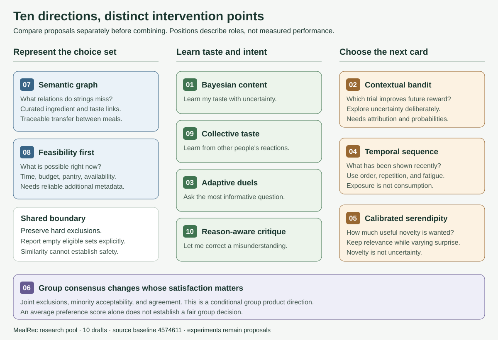

# Ten directions for MealRec's next engine

**Research pool · 10 drafts · 2026-10-17 · source baseline `4574611`**

Ori asked for ten meaningfully different directions, researched by Sol agents at max reasoning. Three `gpt-6.1-sol` agents investigated separate parts of this pool, and the parent checked the current code, ran controlled probes, and reconciled the comparison. “This game” is interpreted as the meal-discovery and reaction loop in this repository.

The pool explores five different questions: what represents a meal, how taste is learned, how the next card is chosen, what makes a meal usable now, and whose satisfaction matters. These are proposals to compare. The research does not select a final architecture or implement any of them.

## Read the pool in five minutes

| Draft | The different question it answers | Main mechanism | What must be added or verified |
| --- | --- | --- | --- |
| [01 · Bayesian content](01-bayesian-content.md) | What can a few of **my** reactions teach about unseen meals? | Regularized feature preferences with uncertainty | Feature encoding; enough explicit labels to check calibration |
| [02 · Contextual bandit](02-contextual-bandit.md) | Which recommendation is worth trying to improve **future** choices? | A policy balancing reward and information | Impression attribution, known probabilities, support, and a validated reward |
| [03 · Adaptive elicitation](03-adaptive-elicitation.md) | Which short question learns the most with the least effort? | Informative meal duels with a question budget | Pairwise answers, ties/skips, and burden measurement |
| [04 · Temporal sequence](04-temporal-sequence.md) | How should a good meal change value after recent exposures? | Separate durable taste from session repetition and fatigue | Append-only exposure history and session state |
| [05 · Calibrated serendipity](05-calibrated-serendipity.md) | Can “surprise me” mean useful novelty at a chosen level? | Relevance-constrained novelty and diversity | Familiarity evidence and user-rated useful surprise |
| [06 · Group consensus](06-group-consensus.md) | Which meal can several people accept fairly? | Joint constraints, minority protection, and agreement | An actual group use case, member inputs, and group outcomes |
| [07 · Semantic graph](07-semantic-graph.md) | Which meaningful relations do raw strings and cuisine miss? | Curated meal–ingredient–taste relations with provenance | A small audited vocabulary and traceable relations |
| [08 · Feasibility first](08-feasibility-first.md) | Which appealing meals are actually possible **now**? | Explicit feasibility constraints before preference ranking | Reliable time/budget/pantry/availability data and session intent |
| [09 · Collective taste](09-collective-taste.md) | What can **other people** teach that my features cannot? | A content-backed collaborative residual with shrinkage | Sufficient real overlap; prove an incremental gain over content |
| [10 · Reason-aware critique](10-reason-aware-critique.md) | How can I correct the engine when it misunderstands a rejection? | Explicit reasons, temporary intent, and faithful steering | Reason/expiry inputs and a reversible preference update |

Each draft contains evidence, an app-specific hypothesis, a concrete mechanism, a hypothetical example, data gaps, failure modes, and a falsifiable experiment. Numeric thresholds are provisional targets, not findings.

## Where I would start

My recommendation is to test **04 and 05 separately** first: reduce repetitive sequences, and determine whether the existing surprise control can produce useful novelty. Both address the current single-card loop without assuming a large user base. They still require prospective exposure/familiarity evidence; the existing feedback table cannot prove either benefit.

Use **01** as a candidate preference model once a small prospective study can distinguish calibrated learning from the current coarse similarity rule. Test **03** if meal duels are an attractive part of the game, and **10** if users struggle to express “I like this, just not now.” These are alternative interaction hypotheses with different friction, not mandatory onboarding additions.

**07** deserves a bounded vocabulary audit before a graph-model investment. **02** should wait for reward and logging readiness. **09** should wait until real reaction overlap supports a collaborative signal. **06 and 08** are conditional product directions: group agreement and practical meal choice are different jobs from discovering appealing food, and their value needs evidence from users before building them.

This ordering is engineering judgment based on the inspected code and missing data. It is not a measured ranking of expected uplift.

## Differences that must survive a prototype

| Easy to conflate | Required distinction |
| --- | --- |
| 01 vs 09 | 01 learns from one person's features and reactions; 09 must demonstrate value specifically from other people's behavior. |
| 02 vs 05 | 02 explores to reduce uncertainty about future reward; 05 chooses useful novelty even when preferences are already known. |
| 03 vs 10 | 03 chooses questions to resolve uncertainty; 10 lets the person correct an actual misunderstanding. |
| 04 vs 05 | 04 responds to order, recency, and fatigue; 05 changes the desired novelty/relevance mix. |
| 07 vs 01 | 07 changes the representation and meaning of similarity; 01 changes how personal weights and confidence are learned. |
| 08 vs 10 | 08 determines whether a meal can satisfy today's task; 10 determines how a rejection changes the engine's state. |
| 06 vs averaging preferences | 06 is only meaningful if minority acceptability and group agreement affect the decision. |

Some directions can combine later, but evaluating a combination first would hide which contribution helped. Every proposal retains hard exclusions and reports an empty eligible set explicitly.

## What is known, and what remains a hypothesis

The shipped engine is a fixed-weight scorer with top-five sampling over a random candidate subset. The seed has 91 meals, 40 cuisine labels, 163 ingredient strings, and 86 flavor tags. The code records the latest signed-in reaction per user and meal; it records neither impressions nor confirmed choices. The [baseline and evaluation note](baseline-and-evaluation.md) links the inspected source, gives reproducible probes, explains sampling omissions, and defines a fair comparison.

There is no production traffic audit, user study, model training run, or measured uplift in this research. Primary papers establish methods in their original settings; transfer to this meal game is the hypothesis each experiment should test. The historical retrospective contains superseded findings and was not used as current implementation evidence.

The [completion audit](AUDIT.md) records how the ten-draft requirement, distinctness, source checks, and document links were verified. Source citations live beside claims in each draft; their source lists explain what the papers support.
