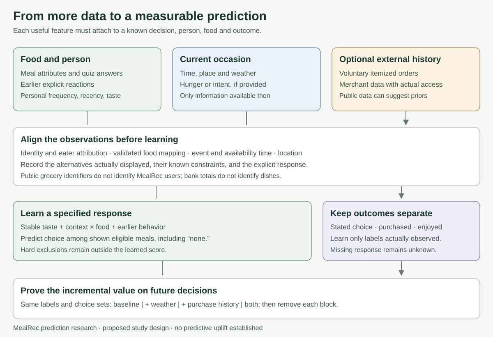

# Learning what someone may want: a predictive strategy for MealRec

Research checked 2026-10-17. Ori's access constraint: no existing food-purchase data. This follow-up examines prediction and data fusion; the [ten earlier drafts](README.md) cover a broader research pool. No predictor was trained and no user records were collected.

**Recommendation:** investigate a learned **contextual choice model**. Combine personal taste, recent food history, food attributes, current occasion, and weather; include price and availability when predicting an actual purchase. Start with a regularized model whose added data blocks can be tested separately. The immediate bottleneck is linked decision/outcome data, rather than access to more weather measurements. That is our assessment from the inspected code and evidence, not a measured ranking of future gains.

## What we can claim about today's engine

Its score uses hand-selected weights, coarse similarity, and random selection. The weather utility exists, but the browser supplies no weather and the route defaults to `normal`; the weather bonus is a fixed 0.2. Feedback overwrites the latest signed-in reaction to each meal. There is no recorded choice set, confirmed meal choice, itemized purchase, or later satisfaction. These facts do **not** establish that the heuristic is bad; they establish that predictive accuracy and the benefit of weather have not been demonstrated. ([Core](../../../packages/core/src/recommender.ts), [weather utility](../../../packages/core/src/weather.ts), [home](../../../meal-rec/src/app/page.tsx), [API](../../../meal-rec/src/app/api/recommend/route.ts), [feedback schema](../../../packages/database/src/models/feedback.ts).)

## Define the prediction before the model

“Want” needs an observable proxy. For this app, start with **which displayed eligible meal someone explicitly selects now, including “none of these.”** That is stated current choice. Purchasing, eating, and enjoying the meal afterwards remain separate outcomes. Do not label silence as “none,” an unshown dish as disliked, or a grocery transaction as a particular meal eaten.

One training example is an occasion: a person, a timestamp and setting, the alternatives actually displayed, the information available before the response, and the selected meal or explicit outside option. Preserve the whole occasion. The current one-card reaction history cannot reconstruct these choice examples retrospectively.

A useful conceptual model is:

```text
meal utility = population preference for this meal
             + this person's taste × meal attributes
             + current context × meal attributes
             + recent-history effects
             + known purchase friction, when relevant

P(select meal) = exp(its utility)
                / [exp(none utility) + sum exp(utilities of shown eligible meals)]
```

This is a proposed adaptation of discrete-choice methods, with partial pooling so sparse personal estimates stay close to population estimates. Such models have assumptions about unobserved preferences and substitution; a simple logit is a starting benchmark, not a proven description of food decisions. ([Repeated-choice mixed logit](https://eml.berkeley.edu/~train/papers/revelttrain.pdf); [methods appendix](predictive-methods-evidence.md).)

**Weather must distinguish alternatives.** Adding the same temperature term to every meal cancels from their relative probabilities. “Temperature × soup attributes” can change their ranking; a shared food-versus-none effect can change willingness to choose anything. Signs must be learned. A local arithmetic check confirmed this property with hypothetical utilities; it is not evidence that people prefer soup in cold weather.



## What the research establishes

| Evidence | What it supports | Important limit |
| --- | --- | --- |
| Burger King next-item prediction used the current basket plus weather, time and store context; reported top-three accuracy was 46.24% for a sequence RNN and 52.37% for TxT. | Combining behavior and context can improve a concrete food-prediction task. | Architecture also changed; the study does not isolate weather or predict an individual's unrestricted meal desire. ([Wang et al.](https://arxiv.org/pdf/2010.06197).) |
| A MyFitnessPal study reported nDCG@5 of .440 for personal favorites and .465 after adding population/temporal effects. | Personal frequency and recency deserve strong baseline status. | Next-day self-reported foods, selected journalers, and no unseen-user/item evaluation. ([Liu et al.](https://arxiv.org/pdf/1909.07683).) |
| Food-context factorization was tested on hunger-conditioned menu ratings. | Occasion can be modeled jointly with people and foods. | Small rating study; not weather or purchase validation. ([Rendle et al.](https://www.ismll.uni-hildesheim.de/pub/pdfs/Rendle_et_al2011-Context_Aware.pdf).) |

The [empirical evidence appendix](food-context-evidence.md) inspects seven studies, including grocery histories, weather-related food mentions, and aggregate card spending. Those outcomes require different interpretations. In the inspected sources, isolated weather-specific improvement for personal next-dish choice remains unproven. This is a targeted research review, not a claim that no such study exists.

## Which external data are realistic?

| Data | Realistic use | Access or alignment issue |
| --- | --- | --- |
| **Weather** | Temperature, rain and seasonal anomalies interacting with food attributes and occasion. | Needs decision time and location. For future recommendations, use forecasts available then; retrospectively observed weather leaks future information. [Open-Meteo documents](https://open-meteo.com/en/docs/historical-forecast-api) distinguish stitched histories from individual forecast runs. |
| **Personal app history** | Stable taste, familiarity, recency and variation. | Most directly aligned with the app, but requires append-only occasions and explicit outcomes. The existing table is lossy. |
| **Voluntary itemized order exports** | Prior dishes, ingredients, frequency, recency and price context where recorded. | Uber documents ordered items, prices and order times in exports. Coverage, who ate the order, dish mapping, and local format still need inspection. This is a prospective user-provided-file route. ([Uber export contents](https://help.uber.com/ubereats/stores/article/whats-in-your-uber-data-download?nodeId=a5ec7ca1-6b85-4ba0-a806-065943a25b46).) |
| **Merchant orders** | Actual itemized transactions and known menu offers. | Square exposes order line items, but access requires a participating merchant and permissions. Buyer bank-link consent does not grant merchant order access. ([Square Orders](https://developer.squareup.com/docs/orders-api/what-it-does).) |
| **Ordinary bank transactions** | Coarse restaurant habits or spending proxies. | The inspected Plaid object contains merchant/amount/category, with no dish line-item list. A restaurant payment does not identify dinner. ([Plaid schema](https://plaid.com/docs/api/products/transactions/).) |
| **Public grocery/recipe datasets** | Benchmark methods or learn candidate content/population priors. | Different people and item spaces; incomplete calendar/location information; download and reuse terms vary. They cannot supply same-person MealRec labels. See the [access matrix](data-access-evidence.md). |

Purchases can improve behavioral prediction while remaining imperfect taste evidence: price, promotion, stock, household sharing, and the available menu affect what is bought. Grocery ingredients also have a many-to-many relationship with prepared dishes. Keep uncertain mappings explicit. If preference and purchase labels eventually coexist, test separate prediction heads and validate whether sharing information helps; do not manufacture satisfaction labels from purchases.

A plausible combination is **this person's recent itemized dishes + reviewed meal attributes + local occasion + weather known at that time**. Another is **actual displayed offers + price/availability + prior purchases** for purchase prediction. Public recipe representations could help unfamiliar-meal content features; they are not pretrained knowledge of this person's wants. These are hypotheses to compare on local outcomes.

## Which models should compete?

| Candidate | What it contributes | When to investigate |
| --- | --- | --- |
| **Regularized contextual choice model** | Explicit interactions and shrunk personal taste effects; inspectable probabilities. | First learned challenger once aligned choice labels exist. |
| **Boosted trees / CatBoost** | Nonlinear interactions without specifying every weather/food combination manually. | Compare on the same tabular features and held-out occasions. [CatBoost](https://proceedings.neurips.cc/paper/2018/file/14491b756b3a51daac41c24863285549-Paper.pdf) establishes a method, not a MealRec accuracy guarantee. |
| **Context-aware factorization** | Shares sparse user–food–context patterns, with metadata for new foods. | When repeated observations and overlapping histories support factors. |
| **Sequence or multiple-outcome models** | Order-sensitive histories or shared representations with separate choice/purchase/satisfaction targets. | Only after simpler history features and genuinely observed targets justify the added complexity. |

No universal record count chooses the winner. Use learning curves, coverage, uncertainty and costs. A personal-favorites or regularized-content baseline may win. The [methods appendix](predictive-methods-evidence.md) compares assumptions, cold start, transfer and prediction targets in more detail.

## How to establish that a data combination helps

Use identical future decision labels, displayed alternatives, covered users, and comparable tuning budgets. Keep exclusions and any known offer/price controls constant. Test the following feature blocks on at least the simple model and a tabular challenger:

| Comparison | Question it answers |
| --- | --- |
| Popularity, personal favorites/recency, and the shipped heuristic | Are the learned models beating useful simple baselines? |
| Personal taste + food attributes + ordinary time/occasion/location | What can we predict before adding external sources? |
| Above + weather/food interactions | Does weather add value beyond the calendar and location? |
| Above + verified prior itemized purchases, without weather | Does purchase history add value beyond app history? |
| Above + both weather and purchase history | Is the combination useful? Remove each block again to assess dependence on the other. |

Use earlier training, later validation and an untouched future test; separately evaluate new users and returning users. Fit climatologies and encodings on training data only. Keep complete sessions together, use records available before each decision, and evaluate archived weather at the actual forecast horizon. Report missing-data coverage and geographic/seasonal transfer limits.

Measure choice log loss, calibration and ranking within the observed displayed alternatives, then user outcomes such as a confirmed acceptable choice and later satisfaction. These labels do not establish full-catalog ranking quality. The heuristic's internal sampling probabilities are not calibrated human choice probabilities: compare rankings directly, or fit a score-to-probability baseline on development data. Resample users and shared time/location blocks for uncertainty. An offline improvement still needs a prospective policy comparison before claiming better recommendations.

Before collecting results, set the smallest benefit worth the acquisition effort, latency and maintenance cost. Drop a source if its gain disappears with proper controls or its mappings/coverage are unreliable. Inconclusive evidence means unproven value, not that the signal is impossible. No numerical MealRec uplift or required sample size follows from the papers reviewed here.

## What to do next

The next research artifact should be an **aligned prediction dataset and benchmark**, beginning with prospective stated choices, personal-history baselines, food attributes and modest occasion information. Weather is a low-friction ablation once time/place are recorded. Separately inspect a small permitted set of itemized exports to determine whether usable dish histories exist in the intended market. Add external history only after that audit; choose advanced model architecture from the resulting evidence.

This recommendation revises the emphasis from the earlier discovery-loop experiments toward predictive validity. It does not replace or implement an engine. Source access, code facts and a mathematical interaction check were verified; MealRec predictive accuracy, user benefit, live data coverage and export interoperability were not measured.
